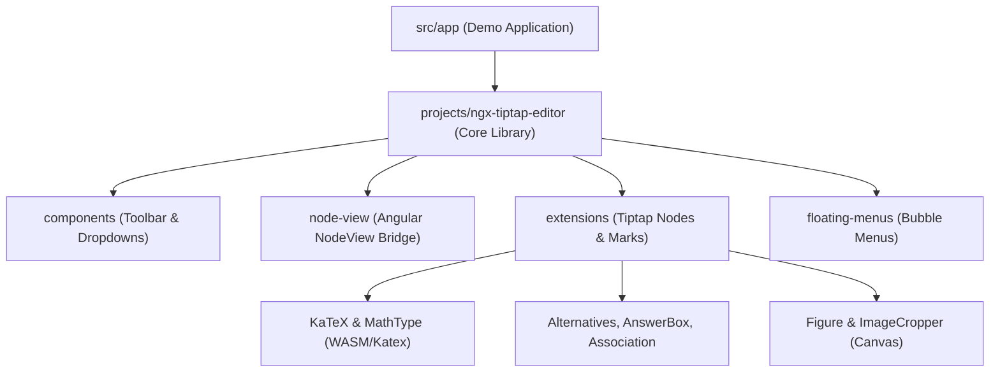

# ngx-tiptap-editor Blueprint

> A powerful, feature-rich Tiptap-based Rich Text Editor for Angular 18+, specifically designed for educational and technical content.

[](https://www.npmjs.com/package/ngx-tiptap-editor)
[](https://angular.dev/)
[](https://tiptap.dev/)

## System Overview

`ngx-tiptap-editor` is a monorepo workspace containing an Angular rich-text editor library and an interactive demonstration application. The system integrates ProseMirror and Tiptap v2 with educational assessment primitives (answer boxes, multiple-choice alternatives, column associations, question paste parsers), mathematical rendering engines (KaTeX and Wiris MathType/ChemType via WebAssembly), and custom figure/canvas image cropping capabilities.



## Local Interface & Invariants

- `[commitlint.config.js]`: Root commit message validation rules conforming to `@commitlint/config-conventional`.
- `[eslint.config.js]`: Workspace ESLint configuration enforcing TypeScript strictness and Angular template rules across projects.
- Invariants: Workspace commit messages and lint rules must pass validation checks prior to release tagging.
- Side Effects: None.

## Subdirectories & System Boundaries

- [projects](./projects/README.md): Angular multi-project workspace folder hosting the publishable `ngx-tiptap-editor` library, its extensions, components, directives, and public API surface.
- [src](./src/README.md): Interactive demonstration application entry point and development harness for testing editor features in an active Angular 18+ browser shell.

## Global Invariants

- **Angular Version Compatibility**: Subsystems depend on standalone Angular component architecture (Angular 18+) with signal-based inputs/outputs and `ControlValueAccessor` contracts.
- **WASM Asset Availability**: MathType features require Wiris telemeter WebAssembly binaries served under `/assets/mathtype/` or equivalent host paths.
- **Non-Destructive Styling**: Font assets for KaTeX are decoupled from the JavaScript bundle to maintain an optimized package footprint (~530 KB), requiring explicit stylesheet inclusion by host consumers.

## Global Side Effects

- **DOM Mutation**: Editor instances mount ProseMirror DOM nodes into component containers and bind window/document event listeners for dragging, resizing, and floating menu positioning.
- **Network Proxying**: Remote image fetching may route through configured server proxy endpoints to bypass browser CORS and mixed-content restrictions.
- **External Dialogs**: MathType integration launches Wiris iframe/modal editors in the global browser window.

## System Verification

- Run: `npm test`

---

## ✨ Features

- 📐 **Scientific Formula Support**: Full [KaTeX](https://katex.org/) and [MathType](https://www.wiris.com/mathtype/) integration.
- 🖼️ **Advanced Image Handling**: Responsive images with figures, captions, alignment, and resizing handles.
- 🛠️ **Custom Extensions**:
  - **Indent**: Control line indentation.
  - **Tab**: Custom tab key behavior.
  - **ColarQuestao**: Specialized tool for pasting educational questions.
- 🎨 **Modern UI**: Clean toolbar and floating menus for formula and image editing.
- ⚡ **Angular 18+ Ready**: Built with the latest Angular features (signals, inputs/outputs).

## 🚀 Installation

To install the library, run:

```bash
npm install ngx-tiptap-editor
```

### Peer Dependencies

This library depends on several Tiptap packages and KaTeX. Ensure you have them installed in your project:

```bash
npm install @tiptap/core @tiptap/pm @tiptap/starter-kit @tiptap/extension-subscript @tiptap/extension-superscript @tiptap/extension-text-align @tiptap/extension-bubble-menu katex
```

## ⚙️ Configuration

### WASM Assets Setup (Required)

To use the **MathType** features properly, you **must** configure your Angular application to serve the WebAssembly files. Update your `angular.json` by adding the following to the `assets` array (in both `build` and `test` targets):

```json
"assets": [
  "src/favicon.ico",
  "src/assets",
  {
    "glob": "**/*.wasm",
    "input": "node_modules/ngx-tiptap-editor/assets/telemeter-wasm",
    "output": "assets/mathtype/"
  }
]
```

> [!IMPORTANT]
> If this configuration is missing, you will encounter `404 (Not Found)` errors for the WebAssembly files when using formulas.

### Styles Setup (KaTeX & MathType)

To maintain an optimized, lightweight library bundle (~530 KB instead of >3 MB), KaTeX font assets are not inlined as Base64 into the JavaScript output.

Include the KaTeX and MathType stylesheets in your application using either approach:

**Option 1: In `angular.json` (Recommended)**

Add the stylesheets to the `styles` array of your project's `build` and `test` targets:

```json
"styles": [
  "node_modules/katex/dist/katex.min.css",
  "node_modules/@wiris/mathtype-html-integration-devkit/styles/styles.css",
  "src/styles.css"
]
```

**Option 2: In your global stylesheet (`src/styles.scss`)**

```scss
@import 'katex/dist/katex.min.css';
@import '@wiris/mathtype-html-integration-devkit/styles/styles.css';
```

> [!TIP]
> If you display rendered HTML content generated by the editor in public/read-only views without the full editor, you can also import `ngx-tiptap-editor/preview.css` for consistent styling.

## 📦 Usage

### 1. Import the Component

In your component file:

```typescript
import { NgxTiptapEditor } from 'ngx-tiptap-editor';

@Component({
  standalone: true,
  imports: [NgxTiptapEditor],
  // ...
})
export class MyAppComponent {
  editorContent = '<p>Initial content with <b>formatting</b></p>';

  handleContentChange(html: string) {
    console.log('New content:', html);
  }
}
```

### 2. Use in Template

```html
<tiptap-editor [content]="editorContent" (onContentChange)="handleContentChange($event)">
</tiptap-editor>
```

---

## 🛠️ API Reference

### Inputs

| Input              | Type                     | Default | Description                                              |
| :----------------- | :----------------------- | :------ | :------------------------------------------------------- |
| `content`          | `string`                 | `""`    | O conteúdo HTML inicial do editor.                       |
| `editable`         | `boolean`                | `true`  | Define se o editor permite digitação/interação.          |
| `extensionsConfig` | `EditorExtensionsConfig` | `null`  | Configurações para extensões (e.g. `image`, `proxyUrl`). |

### Outputs

| Output            | Type             | Description                                              |
| :---------------- | :--------------- | :------------------------------------------------------- |
| `onContentChange` | `output<string>` | Emite o HTML atualizado a cada alteração no documento.   |
| `onEditorReady`   | `output<Editor>` | Emite a instância do Tiptap `Editor` após inicialização. |

### Component Methods & Properties

- `setContent(newContent: string)`: Define programaticamente um novo conteúdo HTML no editor.
- `editorInstance`: Getter que retorna a instância atual do `Editor | null`.

---

## 🧪 Extensions Detail

### 📐 Math & Science

- **KaTeX**: Escreva fórmulas LaTeX com suporte a menu flutuante interativo e preview dinâmico.
- **MathType**: Integração com o editor visual da Wiris (fórmulas matemáticas e químicas via WebAssembly).

### 🎓 Educational Tools

- **AnswerBox (`answerBox`)**: Caixas de resposta configuráveis para exercícios e provas:
  - Modos: `Caixa`, `Linhas`, `Linhas numeradas`.
  - Número dinâmico de linhas (1 a 20).
  - Toggles de cabeçalho personalizável e bordas.
- **Colar Questão (`colarQuestao`)**: Encapsula questões com estrutura padronizada, título imutável em edição de texto e preservação de metadados.
- **Alternative (`alternative`, `alternativeItem`)**: Estrutura para questões de múltipla escolha (A, B, C, D...) com botões de adicionar e remover itens.
- **Association (`association`, `associationColumn`, `associationItem`)**: Tabelas de associação em duas colunas com controle de numeração e alinhamento.

### 📊 Tables

- **Table Extensions**: Tabelas enriquecidas com:
  - Menu flutuante para inserção/remoção de linhas e colunas, mesclagem e divisão de células.
  - Toggles para remoção de bordas externas e verticais.
  - Redimensionamento proporcional e responsivo de largura de colunas.

### 🖼️ Image Management

O editor utiliza a extensão customizada `Figure` que encapsula imagens na tag `<figure>` com suporte a:

- `<figcaption>` com toggle no menu flutuante.
- Menu de alinhamento (`left`, `middle`, `right`, `inlineLeft`, `inlineRight`).
- Redimensionamento rápido de largura (300px a 700px).
- Recorte interativo de imagens (`ImageCropper`) com 8 manipuladores de redimensionamento e exportação automática via Canvas.

#### Image Proxy

When the browser cannot load images directly from external URLs (CORS, mixed-content, etc.), configure a server-side proxy via `extensionsConfig.image.proxyUrl`.

**Import the helper:**

```typescript
import { NgxTiptapEditor, ImageProxyBuilders } from 'ngx-tiptap-editor';
```

**Configure in your component:**

```typescript
extensionsConfig = {
  image: {
    proxyUrl: ImageProxyBuilders.queryParam('https://myserver.com/proxy'),
  },
};
```

```html
<tiptap-editor [extensionsConfig]="extensionsConfig" />
```

**Three built-in URL patterns:**

| Helper                                       | Server receives                  | Best for                  |
| -------------------------------------------- | -------------------------------- | ------------------------- |
| `ImageProxyBuilders.queryParam(base)`        | `GET /proxy?imgurl=<encoded>`    | Proxy simples             |
| `ImageProxyBuilders.queryParam(base, 'url')` | `GET /proxy?url=<encoded>`       | Nome de param customizado |
| `ImageProxyBuilders.pathEncoded(base)`       | `GET /proxy/<encoded>`           | REST paths                |
| `ImageProxyBuilders.postBody(base)`          | `POST /proxy` `{ "url": "..." }` | APIs JSON                 |

**Custom function (avançado):**

```typescript
extensionsConfig = {
  image: {
    proxyUrl: (src: string) => `https://myserver.com/img/${btoa(src)}`,
  },
};
```

**Retrocompatibilidade:** uma `string` simples continua funcionando (usa `queryParam` internamente):

```typescript
// legado — ainda suportado
extensionsConfig = {
  image: {
    proxyUrl: 'https://myserver.com/proxy', // → GET /proxy?imgurl=<encoded>
  },
};
```

> [!TIP]
> Um servidor de teste mínimo está disponível em `tools/proxy_server.py`.
> Basta `python3 tools/proxy_server.py` (porta 8765) para testar localmente.

- **Indent/Outdent**: Standard shortcut and toolbar support.
- **Tab Handling**: Consistent tab behavior within the editor.
- **Colar Questão**: specialized logic for pasting data into educational templates.

---

## 🛠 Development

### Setup

Run `npm install` to install dependencies.

### Development Server

Run `npm run dev` to start a development server for both the library and the test application. This command uses `concurrently` to watch for library changes and serve the app.

### Building

Run `npm run build:lib` to build the library. The build artifacts will be stored in the `dist/ngx-tiptap-editor` directory.

---

## 📜 License

MIT
