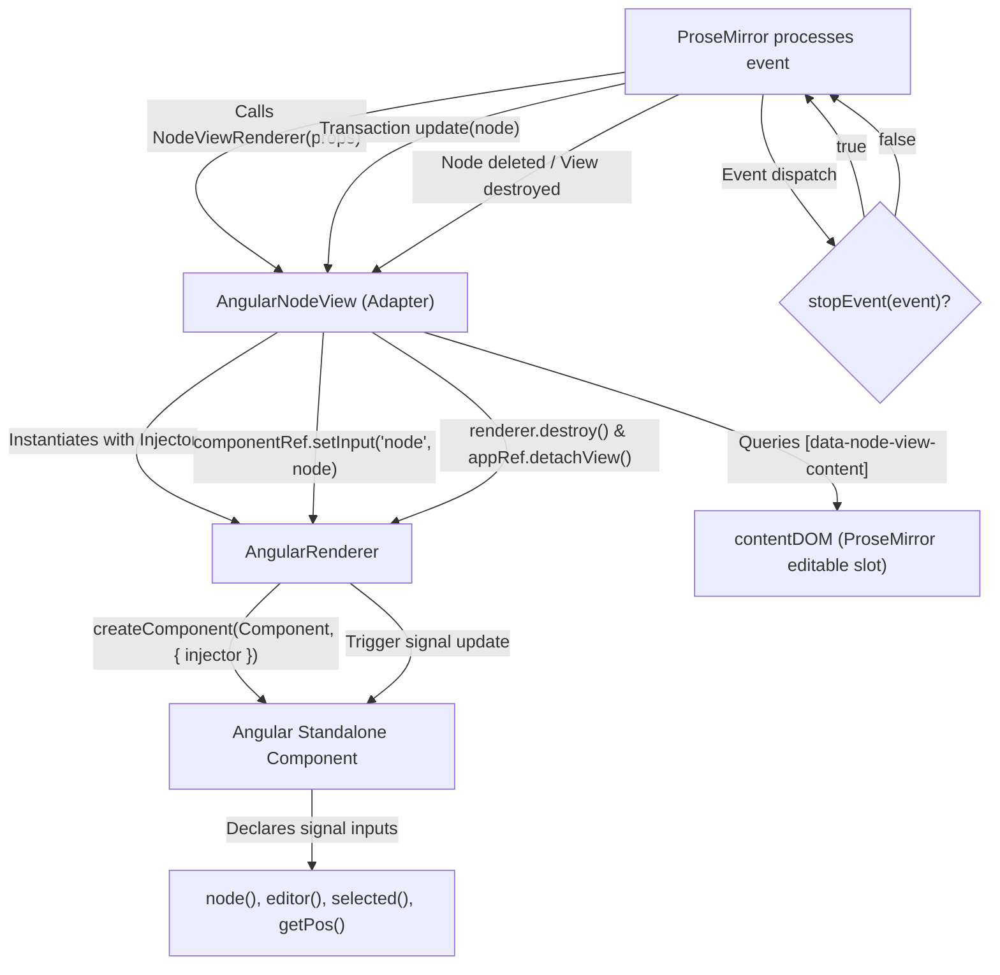

# Design Document: Internalizing Angular NodeView Bridge

- **Author:** marcelinombb
- **Status:** Approved (Ready for Implementation)
- **Date:** 2026-11-05
- **Target Version:** 1.2.0

---

## 1. The Problem

`ngx-tiptap-editor` is an Angular 20 rich text editor library providing specialized extensions for mathematics, formulas, figures, and interactive question widgets. Although the core editor and UI directives are implemented natively within this repository (or customized directly on top of `@tiptap/core`), the library requires `ngx-tiptap` as an external `peerDependency`.

This dependency exists solely to consume three utility constructs that bridge ProseMirror's NodeView interface to Angular's dynamic component system:

1. `AngularNodeViewComponent` (base component defining reactive signal inputs)
2. `AngularNodeViewRenderer` (factory function registering the adapter with Tiptap)
3. `AngularNodeViewRendererOptions` (configuration contract for Angular injector and event predicates)

All other features from `ngx-tiptap`—such as its root editor directive and floating menus—are completely unused. Imposing `ngx-tiptap` as a peer dependency introduces unnecessary packaging and operational friction:

- **Dependency Bloat & Version Pinning**: Consumers of `ngx-tiptap-editor` are forced to declare `ngx-tiptap` and its indirect peer dependencies (notably `@floating-ui/dom`) in their application manifests, even though neither is needed by the consumer.
- **Upstream Release Lag**: Any breaking change or release lag in upstream `ngx-tiptap` maintenance creates an artificial blocker when upgrading Angular major versions or adjusting ProseMirror core packages.

---

## 2. Overview

This design proposes internalizing and adapting the ~150-line Angular NodeView bridge directly into `ngx-tiptap-editor` under the terms of the MIT license.

The internalized bridge will reside in a dedicated module (`projects/ngx-tiptap-editor/src/lib/node-view/`). Public exports via `projects/ngx-tiptap-editor/src/public-api.ts` will be strictly guarded: only `AngularNodeViewComponent`, `AngularNodeViewRenderer`, and `AngularNodeViewRendererOptions` will be exported. Internal orchestration classes (`AngularRenderer` and `AngularNodeView`) will remain private to prevent leaking low-level dynamic component mechanics into the public API.

This architecture completely eliminates `ngx-tiptap` and `@floating-ui/dom` from peer dependency requirements while preserving 100% API compatibility for both internal extensions and third-party custom NodeView components.

---

## 3. Goals & Non-Goals

### In-Scope Goals

- **Eliminate External Peer Dependency**: Remove `"ngx-tiptap"` from `projects/ngx-tiptap-editor/package.json` (`peerDependencies`) and root `package.json` (`dependencies`), updating `package-lock.json` via `npm install`.
- **Self-Contained Bridge Implementation**: Introduce a clean, modular implementation of `AngularRenderer`, `AngularNodeView`, `AngularNodeViewRenderer`, and `AngularNodeViewComponent` in `projects/ngx-tiptap-editor/src/lib/node-view/`.
- **Preserve Public API Contract**: Re-export `AngularNodeViewComponent`, `AngularNodeViewRenderer`, and `AngularNodeViewRendererOptions` from `public-api.ts` so consumers can import them directly from `ngx-tiptap-editor` with zero code refactoring.
- **Maintain Internal Extensions**: Refactor all internal NodeView components (`FigureComponent`, `AnswerBoxComponent`, `ColarQuestaoComponent`, `AssociationComponent`, `AlternativeComponent`) to import from relative path `../../node-view`.
- **Automated Unit Test Coverage**: Provision dedicated unit tests (`angular-node-view.spec.ts`) verifying dynamic component mounting, signal propagation, and clean teardown, validated via `npm run test:ci`.
- **Legal Attribution Compliance**: Include full MIT copyright headers in the extracted files crediting the original author (Sibiraj) per the MIT License.
- **Semantic Version Bump**: Bump library version to `1.2.0` in `projects/ngx-tiptap-editor/package.json`.
- **Documentation Updates**: Update internal skills and guides (`.agents/skills/tiptap-angular-nodeview/SKILL.md`) to reflect the internal import path and patterns.

### Out-of-Scope Non-Goals

- **Re-implementing Unused Directives**: Will not implement or export unused upstream directives (`TiptapEditorDirective`, `TiptapFloatingMenuDirective`, `TiptapDraggableDirective`, `TiptapNodeViewContentDirective`). Editable content projection relies directly on the standard HTML attribute `[data-node-view-content]` declared in component templates.
- **Exporting Internal Plumbing**: Will not export `AngularRenderer` or `AngularNodeView` to the public API surface.
- **Rewriting NodeView API Contracts**: Will not alter the signature of `AngularNodeViewComponent` or input signal names.
- **Refactoring Existing Extension Business Logic**: Extension components (such as image cropping or formula rendering) will not have their internal business logic changed; only their import specifiers will be updated.

---

## 4. Technical Plan

### 4.1 Architecture & Module Layout

The bridge logic will be organized in a dedicated directory: `projects/ngx-tiptap-editor/src/lib/node-view/`.

```
projects/ngx-tiptap-editor/src/lib/node-view/
├── angular-node-view.component.ts   # Base component declaring reactive signal inputs
├── angular-renderer.ts              # Dynamic component instantiator & input updater
├── angular-node-view.ts             # ProseMirror NodeView adapter class
├── angular-node-view-renderer.ts    # Tiptap NodeViewRenderer factory function & options interface
├── angular-node-view.spec.ts        # Unit test suite for bridge mounting and lifecycle
└── index.ts                         # Module export barrel
```

### 4.2 Component & Bridge Responsibilities

1. **`AngularRenderer<C, P>` (Internal Class)**:
   - Accepts a component class `ViewComponent: Type<C>`, an Angular `Injector`, and initial input property records `props: Partial<P>`.
   - Obtains `ApplicationRef` from injector.
   - Calls `createComponent(ViewComponent, { injector, environmentInjector: this.applicationRef.injector })`.
   - Sets initial props using `componentRef.setInput(key, value)`.
   - Attaches host view to `ApplicationRef`: `this.applicationRef.attachView(this.componentRef.hostView)`.
   - Exposes methods:
     - `updateProps(props)`: iterates over key/value pairs and invokes `this.componentRef.setInput(key, value)`.
     - `updateAttributes(attributes)`: sets DOM attributes directly on native host element.
     - `detectChanges()`: invokes `this.componentRef.changeDetectorRef.detectChanges()`.
     - `destroy()`: calls `this.componentRef.destroy()` and `this.applicationRef.detachView(this.componentRef.hostView)`.

2. **`AngularNodeView` (Internal Class)**:
   - Subclasses `NodeView` from `@tiptap/core`.
   - Implements ProseMirror lifecycle hooks:
     - `mount()`: instantiates `AngularRenderer`, binds drag handlers if `extension.config.draggable` is set, queries `[data-node-view-content]` from rendered DOM for non-leaf container nodes, and attaches selection update listener.
     - `dom`: returns `this.renderer.dom`.
     - `contentDOM`: returns `this.contentDOMElement` for non-leaf container nodes, or `null` for leaf nodes.
     - `stopEvent(event: Event)`: allows interactive elements (buttons, inputs, selects, contenteditable elements) to handle events locally without ProseMirror intercepting them, delegating to `options.stopEvent` if defined.
     - `ignoreMutation(mutation: MutationRecord)`: ignores DOM mutations occurring inside the Angular component tree unless mutations target the editable `contentDOMElement`.
     - `update(node, decorations, innerDecorations)`: handles ProseMirror update transactions. Re-applies inputs via `renderer.updateProps(...)` and updates DOM attributes.
     - `selectNode()` / `deselectNode()`: updates `selected` property on the component instance via `setInput('selected', boolean)`.
     - `destroy()`: unbinds editor selection events and invokes `this.renderer.destroy()`.

3. **`AngularNodeViewComponent` (Public Base Class)**:
   - Declares Angular signal inputs conforming to Tiptap node view properties:
     - `readonly editor = input.required<Editor>()`
     - `readonly node = input.required<Node>()`
     - `readonly decorations = input.required<readonly DecorationWithType[]>()`
     - `readonly innerDecorations = input.required<DecorationSource>()`
     - `readonly view = input.required<EditorView>()`
     - `readonly selected = input.required<boolean>()`
     - `readonly extension = input.required<NodeExtension>()`
     - `readonly HTMLAttributes = input.required<Record<string, any>>()` _(Note: PascalCase is retained intentionally to preserve upstream compatibility with existing extension implementations)_
     - `readonly getPos = input.required<() => number | undefined>()`
     - `readonly updateAttributes = input.required<(attributes: Record<string, any>) => void>()`
     - `readonly deleteNode = input.required<() => void>()`

4. **`AngularNodeViewRendererOptions` (Public Interface)**:
   - Defines configuration options accepted by the renderer factory:
     ```typescript
     export interface AngularNodeViewRendererOptions {
       injector: Injector;
       stopEvent?: ((event: Event) => boolean) | null;
       update?:
         | ((props: {
             oldNode: Node;
             newNode: Node;
             oldDecorations: readonly Decoration[];
             newDecorations: readonly Decoration[];
             innerDecorations: DecorationSource;
             updateProps: () => void;
           }) => boolean)
         | null;
     }
     ```

5. **`AngularNodeViewRenderer` (Public Factory)**:
   - Factory returning a `NodeViewRenderer` function that ProseMirror calls when mounting matching nodes:
     ```typescript
     export const AngularNodeViewRenderer = (
       component: Type<AngularNodeViewComponent>,
       options: Partial<AngularNodeViewRendererOptions>,
     ): NodeViewRenderer => {
       return (props) => new AngularNodeView(component, props, options);
     };
     ```

### 4.3 Data Flow & Lifecycle Diagram



### 4.4 Legal Attribution Header

Every newly added file in `projects/ngx-tiptap-editor/src/lib/node-view/` will include the following header:

```typescript
/**
 * Portions of this code are derived from ngx-tiptap (MIT License)
 * Copyright (c) 2020-present Sibiraj <https://github.com/sibiraj-s/ngx-tiptap>
 * Adapted and maintained for ngx-tiptap-editor.
 */
```

### 4.5 Public API Export & Import Migration

- `projects/ngx-tiptap-editor/src/public-api.ts` will selectively export:
  ```typescript
  export {
    AngularNodeViewComponent,
    AngularNodeViewRenderer,
    type AngularNodeViewRendererOptions,
  } from './lib/node-view';
  ```
- Internal extensions (`Figure`, `AnswerBox`, `ColarQuestao`, `Association`, `Alternatives`) will replace external imports:
  ```typescript
  // Before:
  import { AngularNodeViewComponent, AngularNodeViewRenderer } from 'ngx-tiptap';

  // After:
  import { AngularNodeViewComponent, AngularNodeViewRenderer } from '../../node-view';
  ```

---

## 5. Alternatives Considered

### Alternative 1: Retain `ngx-tiptap` as a Peer Dependency

- **Description**: Continue declaring `ngx-tiptap: "^14.0.1"` as a peer dependency of `ngx-tiptap-editor`.
- **Technical Reason for Rejection**: Forces every consumer application of `ngx-tiptap-editor` to explicitly declare `ngx-tiptap` and its transient peer dependency `@floating-ui/dom` in their own root `package.json`, even though 90% of `ngx-tiptap`'s code (editor directives, bubble/floating menus) is bypassed in this codebase. Furthermore, it subjects the project to upstream release stalls when migrating Angular major versions or updating ProseMirror versions.

### Alternative 2: Move `ngx-tiptap` to Bundled `dependencies`

- **Description**: Move `ngx-tiptap` from `peerDependencies` to `dependencies` in `projects/ngx-tiptap-editor/package.json`.
- **Technical Reason for Rejection**: In Angular libraries built with `ng-packagr`, declaring another Angular secondary library as a direct runtime dependency rather than a peer dependency results in packaging warnings, duplicated Angular framework tokens at consumer bundle time, and potential duplicate instances of Angular symbols.

### Alternative 3: Clean-Room Re-architecture with a Brand New NodeView Interface

- **Description**: Invent a proprietary NodeView abstraction with novel registration APIs and distinct component contracts instead of mirroring the existing `AngularNodeViewComponent` and `AngularNodeViewRenderer`.
- **Technical Reason for Rejection**: Unnecessarily breaks backwards compatibility for existing extensions within this repository (`AnswerBox`, `Figure`, `ColarQuestao`, `Association`, `Alternative`) and any third-party consumers who have implemented custom extensions against the `AngularNodeViewRenderer` interface.

---

## 6. Detailed Implementation Plan

### 6.1 Execution Phases & Workflows

1. **Phase 1: Bridge Module Creation & Unit Testing**
   - Scaffold `projects/ngx-tiptap-editor/src/lib/node-view/`.
   - Implement `angular-node-view.component.ts`, `angular-renderer.ts`, `angular-node-view.ts`, and `angular-node-view-renderer.ts` with MIT attribution headers.
   - Add `angular-node-view.spec.ts` testing component instantiation, signal input bindings, and view destruction.
   - Export public symbols via `index.ts`.

2. **Phase 2: Public API Integration**
   - Add guarded export statement to `projects/ngx-tiptap-editor/src/public-api.ts`.

3. **Phase 3: Internal Extensions Refactoring**
   - Update import specifiers in all 5 extension suites (`AnswerBox`, `Alternatives`, `Association`, `ColarQuestao`, `Figure`) to use relative path `../../node-view`.

4. **Phase 4: Dependency Pruning, Lockfile Synchronization & Version Bump**
   - Remove `ngx-tiptap` from `projects/ngx-tiptap-editor/package.json` (`peerDependencies`).
   - Remove `ngx-tiptap` from root `package.json` (`dependencies`).
   - Execute `npm install` to update `package-lock.json` and prune `node_modules`.
   - Bump version to `1.2.0` in `projects/ngx-tiptap-editor/package.json`.
   - Update `.agents/skills/tiptap-angular-nodeview/SKILL.md` guidance.

5. **Phase 5: Verification & Quality Assurance**
   - Run automated test suite: `npm run test:ci`.
   - Run library compilation: `npm run build:lib`.
   - Run application build: `npm run build`.
   - Run linting and code style checks: `npm run lint` and `npm run format:check`.
   - Verify runtime rendering in demo editor by verifying interactive NodeView widgets (`Figure`, `AnswerBox`).

### 6.2 Affected Files & Rationale

| Phase | Action     | File Path                                                                                   | Rationale                                                                                                                                                        |
| :---- | :--------- | :------------------------------------------------------------------------------------------ | :--------------------------------------------------------------------------------------------------------------------------------------------------------------- |
| **1** | **Create** | `projects/ngx-tiptap-editor/src/lib/node-view/angular-node-view.component.ts`               | Defines the standalone base component contract and signal input properties (`editor`, `node`, `selected`, etc.) required by custom Angular NodeViews.            |
| **1** | **Create** | `projects/ngx-tiptap-editor/src/lib/node-view/angular-renderer.ts`                          | Implements `AngularRenderer<C, P>` to dynamically create Angular components using `createComponent()` and push input updates via `ComponentRef.setInput()`.      |
| **1** | **Create** | `projects/ngx-tiptap-editor/src/lib/node-view/angular-node-view.ts`                         | Implements the ProseMirror `NodeView` subclass coordinating DOM mount, `data-node-view-content` projection, `stopEvent`, `ignoreMutation`, and view destruction. |
| **1** | **Create** | `projects/ngx-tiptap-editor/src/lib/node-view/angular-node-view-renderer.ts`                | Provides the `AngularNodeViewRenderer()` factory function and `AngularNodeViewRendererOptions` interface.                                                        |
| **1** | **Create** | `projects/ngx-tiptap-editor/src/lib/node-view/angular-node-view.spec.ts`                    | Unit test suite testing component mounting, signal input synchronization, and teardown.                                                                          |
| **1** | **Create** | `projects/ngx-tiptap-editor/src/lib/node-view/index.ts`                                     | Barrel export aggregating node-view bridge utilities and interfaces.                                                                                             |
| **2** | **Modify** | `projects/ngx-tiptap-editor/src/public-api.ts`                                              | Selectively exposes `AngularNodeViewComponent`, `AngularNodeViewRenderer`, and `AngularNodeViewRendererOptions` on the public surface.                           |
| **3** | **Modify** | `projects/ngx-tiptap-editor/src/lib/extensions/answer-box/answer-box.component.ts`          | Updates import of `AngularNodeViewComponent` to `../../node-view`.                                                                                               |
| **3** | **Modify** | `projects/ngx-tiptap-editor/src/lib/extensions/answer-box/answer-box.ts`                    | Updates import of `AngularNodeViewRenderer` to `../../node-view`.                                                                                                |
| **3** | **Modify** | `projects/ngx-tiptap-editor/src/lib/extensions/alternatives/alternative.ts`                 | Updates import of `AngularNodeViewRenderer` to `../../node-view`.                                                                                                |
| **3** | **Modify** | `projects/ngx-tiptap-editor/src/lib/extensions/alternatives/alternative-item.component.ts`  | Updates import of `AngularNodeViewComponent` to `../../node-view`.                                                                                               |
| **3** | **Modify** | `projects/ngx-tiptap-editor/src/lib/extensions/alternatives/alternative-item.ts`            | Updates import of `AngularNodeViewRenderer` to `../../node-view`.                                                                                                |
| **3** | **Modify** | `projects/ngx-tiptap-editor/src/lib/extensions/alternatives/alternative.component.ts`       | Updates import of `AngularNodeViewComponent` to `../../node-view`.                                                                                               |
| **3** | **Modify** | `projects/ngx-tiptap-editor/src/lib/extensions/colar-questao/colar-questao.component.ts`    | Updates import of `AngularNodeViewComponent` to `../../node-view`.                                                                                               |
| **3** | **Modify** | `projects/ngx-tiptap-editor/src/lib/extensions/colar-questao/colar-questao.ts`              | Updates import of `AngularNodeViewRenderer` to `../../node-view`.                                                                                                |
| **3** | **Modify** | `projects/ngx-tiptap-editor/src/lib/extensions/association/association.component.ts`        | Updates import of `AngularNodeViewComponent` to `../../node-view`.                                                                                               |
| **3** | **Modify** | `projects/ngx-tiptap-editor/src/lib/extensions/association/association.ts`                  | Updates import of `AngularNodeViewRenderer` to `../../node-view`.                                                                                                |
| **3** | **Modify** | `projects/ngx-tiptap-editor/src/lib/extensions/association/association-item.component.ts`   | Updates import of `AngularNodeViewComponent` to `../../node-view`.                                                                                               |
| **3** | **Modify** | `projects/ngx-tiptap-editor/src/lib/extensions/association/association-item.ts`             | Updates import of `AngularNodeViewRenderer` to `../../node-view`.                                                                                                |
| **3** | **Modify** | `projects/ngx-tiptap-editor/src/lib/extensions/association/association-column.component.ts` | Updates import of `AngularNodeViewComponent` to `../../node-view`.                                                                                               |
| **3** | **Modify** | `projects/ngx-tiptap-editor/src/lib/extensions/association/association-column.ts`           | Updates import of `AngularNodeViewRenderer` to `../../node-view`.                                                                                                |
| **3** | **Modify** | `projects/ngx-tiptap-editor/src/lib/extensions/image/Figure.ts`                             | Updates import of `AngularNodeViewRenderer` to `../../node-view` _(Note: `Figure.ts` uses PascalCase on disk)_.                                                  |
| **3** | **Modify** | `projects/ngx-tiptap-editor/src/lib/extensions/image/figure.component.ts`                   | Updates import of `AngularNodeViewComponent` to `../../node-view`.                                                                                               |
| **4** | **Modify** | `projects/ngx-tiptap-editor/package.json`                                                   | Removes `"ngx-tiptap"` from `peerDependencies` and bumps version to `1.2.0`.                                                                                     |
| **4** | **Modify** | `package.json`                                                                              | Removes `"ngx-tiptap"` from root project `dependencies`.                                                                                                         |
| **4** | **Modify** | `package-lock.json`                                                                         | Synchronizes dependency tree and prunes `ngx-tiptap` via `npm install`.                                                                                          |
| **4** | **Modify** | `.agents/skills/tiptap-angular-nodeview/SKILL.md`                                           | Updates developer documentation to show imports from `'ngx-tiptap-editor'` instead of `'ngx-tiptap'`.                                                            |
